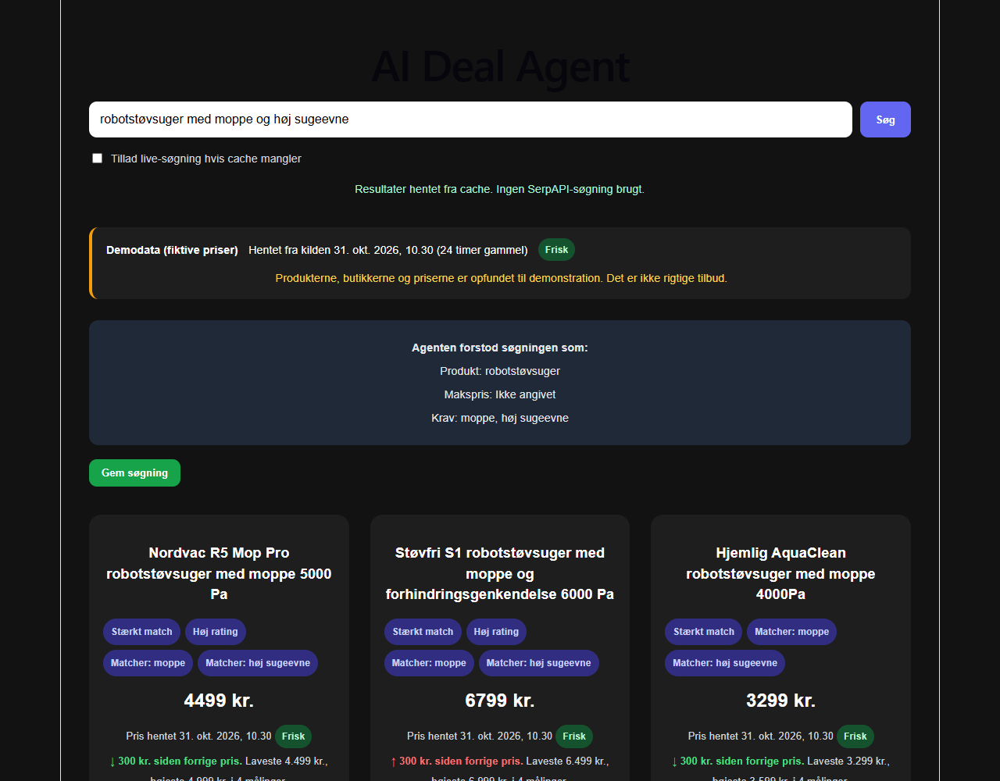
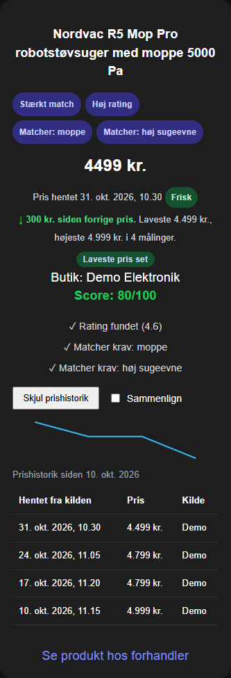
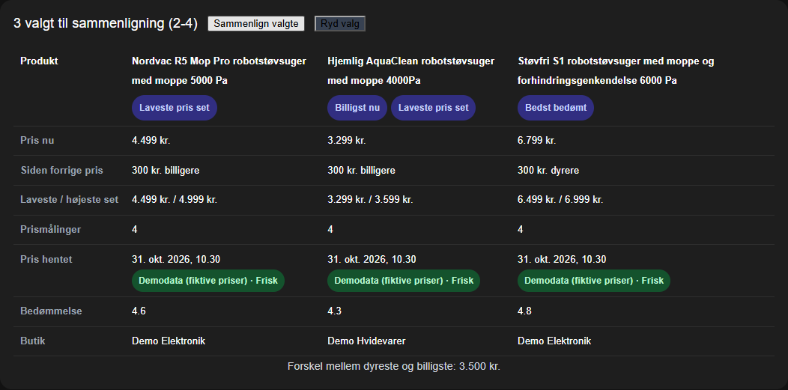

# AI Deal Agent

AI Deal Agent is a full-stack prototype for an AI-assisted product search and deal recommendation tool.

Current version: v1.0

The goal is to let a user describe what they are looking for in natural language, and then return relevant product suggestions with prices, images, match scores, badges, and explanations.

Example search:

```txt
robotstøvsuger med moppe og høj sugeevne
```

The system will try to understand:

```txt
Product type: robotstøvsuger
Required features: moppe, høj sugeevne
Max price: not specified
```

It then searches for products, scores them, and presents the results in a webshop-like interface.

---

## Current Features

- React frontend with product cards
- FastAPI backend
- SerpAPI Google Shopping integration
- Local cache to avoid unnecessary API calls
- Controlled live search to protect API quota
- Configurable frontend API base URL
- Configurable backend CORS origins
- Product scoring
- Product badges
- Recommendation explanations
- Parsed search requirements shown in the UI
- Feature matching with simple Danish/English synonym support
- Saved searches
- Reuse saved searches
- Run saved searches again
- Delete saved searches
- Duplicate protection for saved searches
- Price history stored in SQLite, dated by when the data was fetched from the source
- Source and freshness shown for every search and price (live, cache or demo; fresh, aging or stale)
- Comparison of 2-4 products side by side
- Offline demo with fictional, clearly labelled demo data (no SerpAPI key needed)
- Backend tests with pytest and frontend tests with Vitest

A developer walkthrough of the design, tests and trade-offs is in [docs/PROJECT_WALKTHROUGH.md](docs/PROJECT_WALKTHROUGH.md).

---

## Tech Stack

### Backend

- Python
- FastAPI
- SerpAPI
- python-dotenv
- requests
- pytest

### Frontend

- React
- TypeScript
- Vite
- CSS

---

## Project Structure

```txt
ai-deal-agent/
│
├── app/
│   ├── __init__.py
│   ├── api.py
│   ├── badge_generator.py
│   ├── cache_service.py
│   ├── comparison.py
│   ├── debug_cache.py
│   ├── demo_seed.py
│   ├── explainer.py
│   ├── feature_matcher.py
│   ├── freshness.py
│   ├── models.py
│   ├── price_history.py
│   ├── product_search.py
│   ├── requirements.py
│   ├── requirements_parser.py
│   ├── saved_searches.py
│   ├── scorer.py
│   └── settings.py
│
├── cache/
│   └── cached SerpAPI responses
│
├── data/
│   └── runtime saved searches and price_history.sqlite3
│
├── demo/
│   └── snapshots/ (fictional, dated demo responses)
│
├── docs/
│   ├── PROJECT_WALKTHROUGH.md
│   └── images/
│
├── frontend/
│   ├── src/
│   │   ├── components/
│   │   │   ├── EmptyState.tsx
│   │   │   ├── ProductCard.tsx
│   │   │   ├── ProductGrid.tsx
│   │   │   ├── RequirementsSummary.tsx
│   │   │   ├── SavedSearchesPanel.tsx
│   │   │   └── SearchSection.tsx
│   │   ├── api.ts
│   │   ├── App.tsx
│   │   ├── App.css
│   │   ├── main.tsx
│   │   └── types.ts
│   ├── .env.example
│   └── package.json
│
├── tests/
│   ├── test_feature_matcher.py
│   ├── test_requirements_parser.py
│   ├── test_saved_searches.py
│   └── test_scorer.py
│
├── .env.example
├── .gitignore
├── pytest.ini
├── requirements-dev.txt
├── requirements.txt
└── README.md
```

---

## How It Works

The application follows this flow:

```txt
User search text
        ↓
Requirements parser
        ↓
Product search
        ↓
Cache check
        ↓
SerpAPI call if explicitly allowed
        ↓
Product scoring
        ↓
Badges and explanations
        ↓
Frontend product cards
```

Saved searches follow this flow:

```txt
Completed search
        ↓
Save search
        ↓
Store query, parsed requirements, result count and best score
        ↓
Show saved searches in frontend
        ↓
Reuse, run again or delete saved search
```

---

## Backend Setup

Install Python dependencies:

```bash
pip install -r requirements.txt
```

For development and tests, install the dev requirements instead (adds pytest and httpx2 for FastAPI's TestClient):

```bash
pip install -r requirements-dev.txt
```

Create a `.env` file in the project root.

Use `.env.example` as a template:

```txt
SERPAPI_API_KEY=your_serpapi_key_here
ALLOW_LIVE_SEARCH=false
CORS_ORIGINS=http://localhost:5173,http://127.0.0.1:5173
```

Do not commit `.env` to GitHub.

Start the backend:

```bash
uvicorn app.api:app --reload
```

The API will run at:

```txt
http://127.0.0.1:8000
```

Swagger/OpenAPI documentation is available at:

```txt
http://127.0.0.1:8000/docs
```

---

## Frontend Setup

Go to the frontend folder:

```bash
cd frontend
```

Create a `.env` file inside the `frontend` folder.

Use `frontend/.env.example` as a template:

```txt
VITE_API_BASE_URL=http://127.0.0.1:8000
```

If `VITE_API_BASE_URL` is not set, the frontend falls back to `http://127.0.0.1:8000`.

Install dependencies:

```bash
npm install
```

Start the frontend:

```bash
npm run dev
```

The frontend will run at:

```txt
http://localhost:5173
```

---

## Local Development

For local development, run the backend and frontend in two separate terminals.

### Terminal 1: Backend

From the project root:

```bash
uvicorn app.api:app --reload
```

### Terminal 2: Frontend

From the project root:

```bash
cd frontend
npm run dev
```

Then open:

```txt
http://localhost:5173
```

For normal development, keep live search disabled:

```txt
ALLOW_LIVE_SEARCH=false
```

Use cached searches while developing. Only enable live search when you intentionally want to spend a SerpAPI request.

To allow a new live search, both conditions must be true:

```txt
ALLOW_LIVE_SEARCH=true
```

and the frontend checkbox must be enabled:

```txt
Tillad live-søgning hvis cache mangler
```

After testing live search, set `ALLOW_LIVE_SEARCH` back to `false`.

### Cache files and error handling

Cached responses are stored in `cache/` in the project root, one JSON file per query. The file name is a stable key: a readable label from the query plus the first 16 hex characters of the SHA-256 hash of the normalized query (lowercase, repeated whitespace collapsed), for example `robotstøvsuger_med_moppe-e393725d9d5c75d7.json`. Different queries such as `laptop/16GB` and `laptop?16GB` therefore never share a file, and a query can never write outside the cache folder.

Cache files from older versions (named only from the lowercased query) are still used, but only when the SerpAPI response inside the file records the same query in `search_parameters.q`. Such files are copied to the new name on first use. Files that cannot be proven to belong to the query are ignored.

If SerpAPI is unreachable, times out or returns an error, the API responds with `502 Bad Gateway` and a Danish error message. Error responses are never written to the cache.

---

## API Usage

### Product Search

The main search endpoint is:

```txt
POST /api/search
```

Example request:

```json
{
  "query": "robotstøvsuger med moppe og høj sugeevne",
  "allow_live_search": false
}
```

Example response structure:

```json
{
  "query": "robotstøvsuger med moppe og høj sugeevne",
  "count": 40,
  "used_cache": true,
  "requirements": {
    "product_type": "robotstøvsuger",
    "max_price": null,
    "required_features": [
      "moppe",
      "høj sugeevne"
    ]
  },
  "products": [
    {
      "product": {
        "name": "Example product",
        "price": 3999,
        "url": "https://example.com",
        "image_url": "https://example.com/image.jpg",
        "rating": 4.5,
        "source": "Example Store"
      },
      "score": 75,
      "badges": [
        "Stærkt match",
        "Høj rating"
      ],
      "explanations": [
        "✓ Rating fundet (4.5)",
        "✓ Matcher krav: moppe"
      ]
    }
  ]
}
```

### Saved Searches Endpoints

```txt
GET /api/saved-searches
POST /api/saved-searches
DELETE /api/saved-searches/{saved_search_id}
```

Example save search request:

```json
{
  "query": "robotstøvsuger med moppe og høj sugeevne",
  "result_count": 40,
  "best_score": 75
}
```

Example saved search response:

```json
{
  "saved_search": {
    "id": "example-id",
    "query": "robotstøvsuger med moppe og høj sugeevne",
    "product_type": "robotstøvsuger",
    "max_price": null,
    "required_features": [
      "moppe",
      "høj sugeevne"
    ],
    "result_count": 40,
    "best_score": 75,
    "created_at": "2026-05-13T10:00:00+00:00"
  }
}
```

---

## Cache and Live Search

SerpAPI has a limited number of searches per month, so the project uses local caching.

The backend checks the cache first:

```txt
If cached result exists:
    use cache

If cache does not exist and live search is not allowed:
    return an error

If cache does not exist and live search is allowed:
    call SerpAPI and save the response to cache
```

There are two layers of protection.

### 1. Environment Variable

```txt
ALLOW_LIVE_SEARCH=false
```

This prevents new SerpAPI calls globally.

The backend reads `.env` from the project root once at startup. Variables that are already set in the environment take precedence over `.env`, so restart the backend after changing `.env`.

### 2. Frontend Checkbox

The frontend has a checkbox:

```txt
Tillad live-søgning hvis cache mangler
```

A live SerpAPI call is only made when:

```txt
ALLOW_LIVE_SEARCH=true
```

and the frontend request sends:

```json
{
  "allow_live_search": true
}
```

This prevents accidental API usage during development.

---

## Saved Searches

The application supports saved searches.

A saved search includes:

- Unique id
- Query text
- Parsed product type
- Maximum price
- Required features
- Result count
- Best score
- Creation timestamp

Saved searches are stored locally in:

```txt
data/saved_searches.json
```

The `data/` folder is ignored by Git because it contains runtime data.

The saved search feature currently supports:

- Saving a search
- Listing saved searches
- Reusing a saved search in the search input
- Running a saved search again
- Deleting a saved search
- Preventing duplicate saved searches
- Sorting saved searches newest first

The relevant backend logic is located in:

```txt
app/saved_searches.py
```

The relevant frontend component is located in:

```txt
frontend/src/components/SavedSearchesPanel.tsx
```

---

## Product Scoring

Products are scored based on:

- Price
- Rating
- Required feature matches

The score is capped at 100.

The scoring logic is located in:

```txt
app/scorer.py
```

---

## Feature Matching

Feature matching is handled in:

```txt
app/feature_matcher.py
```

The matcher supports simple Danish/English synonym matching.

Examples:

```txt
trådløs → wireless
vandtæt → waterproof
støjsvag → quiet
usb-c → usb c, usbc, type-c
høj sugeevne → strong suction, suction, pa
```

This makes the agent better at matching Danish user requests with English product titles.

---

## Recommendation Explanations

Each product includes explanations that describe why it received its score.

Example:

```txt
✓ Rating fundet (4.7)
✓ Matcher krav: moppe
? Ikke tydeligt om produktet matcher: høj sugeevne
```

This logic is located in:

```txt
app/explainer.py
```

---

## Product Badges

The frontend displays badges such as:

```txt
Stærkt match
Muligt match
Under budget
Høj rating
Matcher: usb-c
```

Badge logic is located in:

```txt
app/badge_generator.py
```

---

## Price History, Comparison and Freshness



### How prices are recorded

Every search stores the prices it returns in a SQLite database (`data/price_history.sqlite3`, created automatically, ignored by Git). It uses Python's built-in `sqlite3`, so there is no extra service or dependency.

- An observation is dated with the time the data was **fetched from the source**: SerpAPI's `search_metadata.created_at`, or the cache file's time if that is missing. It is never the time the cache was read.
- The same product, fetch time and price is stored once (a unique constraint). Searching the same cached query again therefore adds nothing: the history only grows when new data arrives from a live search or newly loaded snapshots.
- Every observation records its origin: `live` (fetched now from SerpAPI), `cache` (an earlier SerpAPI response) or `demo` (fictional demonstration data).
- A product is identified by SerpAPI's `product_id` when present, otherwise by its normalised name and shop.
- If the history database cannot be written, the search still answers; the history fields are then `null`.

### Freshness

| Age of the data | Status |
| --- | --- |
| under 24 hours | `fresh` (Frisk) |
| 1-7 days | `aging` (Ældre) |
| 7 days or more | `stale` (Forældet) |

The search response has a `data_source` block (`origin`, `origin_label`, `fetched_at`, `age_hours`, `status`). Each product has a `product_id` and a `price_history` summary (latest, lowest and highest price, previous different price, change, number of observations, and whether today's price is the lowest seen). These fields are additions; the existing response fields are unchanged.

### Endpoints

```text
GET /api/products/{product_id}/price-history     all observations, oldest first, plus the summary
GET /api/products/compare?ids=1&ids=2&ids=3      2-4 different products side by side
```

The comparison marks `cheapest_now`, `best_rated` (only when at least two products have a rating) and `lowest_price_seen`, and reports the price spread. Fewer than 2 or more than 4 different ids give `400`; unknown ids give `404`.





### Offline demo with cached data

`demo/snapshots/` contains eight fictional SerpAPI-shaped responses for two example queries, dated 10, 17, 24 and 31 October 2026. Products, shops and prices are invented, links point to `example.com`, and every file carries `"ai_deal_agent_demo": true`. The API and the UI therefore always label them "Demodata (fiktive priser)".

```bash
python -m app.demo_seed
```

This loads every snapshot into the price history and writes the newest snapshot of each query to `cache/`, **only if no cache file exists for that query**. Real cached searches are never overwritten. Running it again adds nothing.

Then start the backend and frontend, keep live search off, and search for:

- `robotstøvsuger med moppe og høj sugeevne`
- `laptop til programmering med 16GB RAM under 8000 kr`

No SerpAPI request is made, and no API key is needed.

---

## Running Tests

Run all backend tests from the project root:

```bash
python -m pytest
```

Current test coverage includes:

- Requirements parsing
- Product scoring
- Feature matching
- Saved searches
- API endpoints with FastAPI's `TestClient` (search, validation, error codes, saved search lifecycle)
- Cache file naming and round trips
- Product search: price parsing, cache-first behaviour, live search guards and SerpAPI failures
- Price history: dating by fetch time, no duplicate history from repeated cache reads, origin per observation, products without price, older data not overwriting newer details, summaries and the database's price constraint
- Freshness thresholds and comparison highlights (including ties and missing values)
- Demo snapshots: marker and dating, idempotent seeding, never overwriting an existing cache file
- API: data source and history in search results, live searches recorded as live, demo labelling, history and comparison endpoints with their 400/404 cases, and search still working when the history database fails

The tests never call SerpAPI and never need an API key. `tests/conftest.py` blocks all outgoing HTTP requests, forces `ALLOW_LIVE_SEARCH=false`, removes `SERPAPI_API_KEY`, and redirects the cache and saved searches to a temporary folder for every test. Live search is tested with a mocked SerpAPI response.

---

### Frontend tests

The frontend has component tests with Vitest, React Testing Library and jsdom. `fetch` is stubbed with a small in-memory fake of the API, so no backend or SerpAPI key is needed:

```bash
cd frontend
npm test
```

They cover the search flow (parsed requirements, cache/live source, ranked products), the live-search checkbox, error messages (backend `detail`, FastAPI validation errors, non-JSON errors, unreachable backend), saving searches with duplicate protection, running and deleting saved searches, product card rendering, the demo data label and fetch times, loading a product's price history, comparing selected products and the limit of four.

---

## Quality Checks

Run backend tests from the project root:

```bash
python -m pytest
```

Lint and build the frontend from the frontend folder:

```bash
cd frontend
npm run lint
npm test
npm run build
```

A healthy project state should have:

```txt
Backend tests passing
Frontend lint and production build passing
Git working tree clean
```

### Continuous integration

GitHub Actions (`.github/workflows/ci.yml`) runs on every push to `main` and on every pull request:

- Backend: installs `requirements-dev.txt` on Python 3.12 and runs `python -m pytest`
- Frontend: `npm ci`, `npm run lint`, `npm test` and `npm run build`

CI sets `ALLOW_LIVE_SEARCH=false` and provides no SerpAPI key, so it can never make paid API calls.

If the frontend build fails because of local path or sync-folder issues, run the build from the actual project folder path used by your system.

---

## Development Notes

The project is intentionally built in small layers:

1. Search input
2. Requirement parsing
3. Product search
4. Cache protection
5. Scoring
6. Explanations
7. Badges
8. Frontend presentation
9. Saved searches
10. Tests

This makes the system easier to understand, debug, and extend.

---

## Current Limitations

- Product links often point to Google Shopping rather than directly to the retailer.
- Product specifications are limited to what Google Shopping returns.
- Feature matching is still rule-based and not yet powered by an LLM.
- The search parser is simple and does not fully understand complex natural language.
- Saved searches are stored in a local JSON file rather than a database.
- There is no user login or multi-user support yet.
- Price history is only as frequent as the searches that bring new data; there is no scheduled price polling (it would spend SerpAPI quota).
- The demo history is fictional; real history builds up only from live searches.
- There is no production deployment yet.

---

## Possible Future Improvements

- Direct retailer link lookup
- Scheduled price polling within an explicit quota budget
- Saved searches in the same SQLite database
- Email or push notifications for price drops
- Affiliate link support
- LLM-based requirement parsing
- LLM-based product analysis
- Review summarization
- Mobile app
- User accounts
- PostgreSQL database
- Deployment to cloud hosting
- Admin dashboard for monitoring searches and cache usage

---

## Purpose

This project is both a learning project and a potential product prototype.

It demonstrates:

- Full-stack development
- API integration
- React frontend development
- FastAPI backend development
- Caching strategy
- Test-driven improvements
- Basic recommendation logic
- Local persistence with JSON storage
- A practical AI-agent style architecture